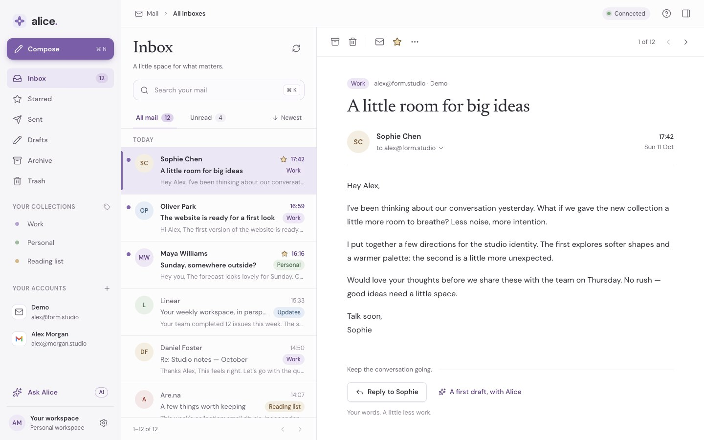
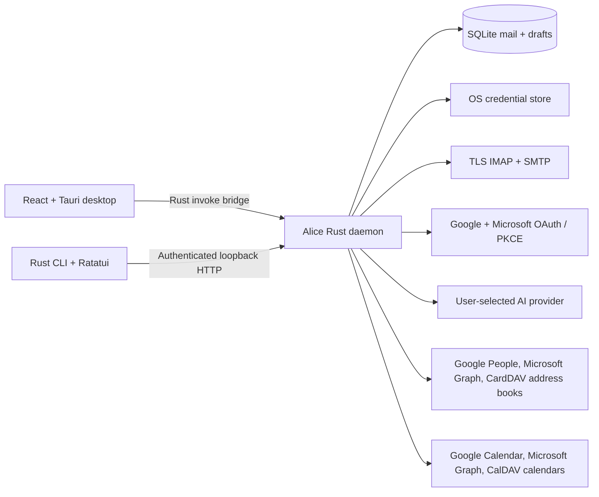

# Alice

An open-source Rust email client with a calmer desktop inbox, a native CLI and TUI, and bring-your-own-key AI. One local daemon owns the mail store, so every interface sees the same messages and drafts.

**Version 0.1 is a runnable foundation.** The demo works without an account or API key. Gmail has passed live macOS app and CLI tests using an app password. Certificate-validated IMAP, SMTP STARTTLS, and SMTPS pass against isolated mail servers. Windows and Linux packages have been built; native Windows runtime and Outlook sign-in remain unverified. Android and iOS are planned. See the [verification report](docs/verification/2026-10-11/report.md) for exact coverage and remaining checks.



## Run

Install Rust 1.95 or newer and Node.js 22.12 or newer. For native desktop builds, install the [Tauri prerequisites](https://tauri.app/start/prerequisites/) for your OS.

```sh
npm ci
npm run dev
```

Open **http://127.0.0.1:1420**. This starts the Rust daemon and the desktop UI in a development browser. The first run opens setup: connect at least one mail account to continue. Setup can also add a demo inbox with sample messages; nothing sent from it is delivered.

For the native desktop application:

```sh
npm run desktop
```

For the CLI and terminal UI:

```sh
cargo install --path crates/alice --locked
alice accounts demo      # optional: sample messages demo-1 … demo-13
alice                    # opens the TUI
alice list
alice list --unread --json
alice read demo-1
alice reply demo-1 --body "Let's explore the softer direction."
alice list --folder drafts
alice send <draft-id>     # explicit send; the demo inbox never delivers email
alice archive demo-2
alice star demo-3
alice sync
alice contacts search soph          # recipients from your mail and address books
alice invite demo-13 accept         # answer an invitation by email
alice calendar export demo-13 --open   # open the event in your calendar app
```

The native app and CLI start the daemon automatically when needed. It continues running when you close the UI. While the desktop app runs, it starts the daemon again if it stops. A client that finds a daemon from a different build (`alice --version` shows the build after the version) stops it and starts its own, so an app update or rebuild never talks to an older daemon's API. Use `alice daemon run` to start it in the foreground for diagnostics, `alice daemon status` to check its health, and `alice daemon stop` to stop it after quitting desktop clients (**Quit Alice** in the menu bar icon, or ⌘Q). `alice discard <draft-id>` removes an unsent local draft without touching provider mail.

### Terminal controls

`j/k` or arrows navigate, `Enter` marks a message read, `PageUp/PageDown` scroll the reader, `r` replies or resumes a draft, `c` composes, `a` archives, `d` moves to Trash, `x` moves a message to Spam (or, in Spam, back to the Inbox), `s` toggles a star, `u` marks unread, `/` searches (`Esc` clears the search), `g` cycles folders, and `S` syncs. `[` and `]` move between mailbox pages. `?` lists every key. The footer always shows the keys for the current mode, and a spinner marks work in progress. `NO_COLOR` is respected.

In the draft editor, `Tab` switches fields, arrows / Home / End move the cursor, and `Ctrl+s` or `Esc` saves and closes. While you type a recipient, matching contacts appear under To: `↓/↑` pick one and `Enter` adds it. The sending account is visible; `F2` changes it for a new draft. Open Drafts with `g`, select a draft, and press `!`, then `y`, to send. In the reader, `i` answers an invitation: `y` accepts, `m` tentatively accepts, `n` declines. `q` exits the TUI. Non-interactive invocations must use a command, such as `alice list --json`.

Desktop shortcuts: with focus in the message list or reader (outside text fields), `j/k` or `↓/↑` move between conversations, `Enter` or `o` opens one from the list, `r` replies (or continues a draft), `e` archives, `#` or `Delete` moves to Trash, `!` marks as spam, `i` moves back to the Inbox (**Not spam** in Spam), `u` toggles read, `s` toggles the star, `/` searches, and `?` lists every shortcut. Anywhere in the mail view, `⌘/Ctrl+N` composes, `⌘/Ctrl+K` searches, `⌘/Ctrl+Shift+N` syncs, `⌘/Ctrl+J` opens Ask Alice, `⌘/Ctrl+,` opens Settings, and `⌘/Ctrl+1`–`7` go to Inbox, Starred, Sent, Drafts, Archive, Trash and Spam. In compose, `⌘/Ctrl+Enter` sends, `⌘/Ctrl+S` saves the draft, and `Esc` saves and closes. **Settings → Keyboard shortcuts** lists them all.

Right-click a conversation, a message in the reader, a link, an attachment, a folder, an account, or the list's empty space for its actions; each menu item shows its shortcut. A right-clicked conversation is acted on without being opened. `Shift+F10` or the Menu key opens the same menu for the focused conversation or message, arrow keys move through it, and an item's own shortcut chooses it. Text fields and selected text keep the system menu. Keyboard navigation is never animated; pointer actions get short transitions built with [Motion](https://motion.dev). With the system's reduced-motion setting, those become fades.

Search is shared by the app, the TUI and `alice list --search`, and runs in the daemon over a local index: words match sender, recipients, subject and body; `"phrases"`, `-exclusions`, `OR`, `from:`, `to:`, `subject:`, `body:`, `is:unread`, `is:starred`, `has:attachment`, and `after:7d` / `before:2026-10` / `date:today` narrow it. A misspelled name still finds its mail, and the best match comes first. Full syntax: [docs/api.md](docs/api.md).

## Languages

Alice supports **English (US)** (`en-US`) and **German** (`de`). Choose **System default**, **English (US)** or **Deutsch** in the account-connection card during setup or under **Settings → Appearance → Language**. The preference is saved on this device and updates the interface without restarting or losing an open draft. Dates, times, numbers and plurals follow the selected language; unsupported system languages fall back to English.

The CLI and TUI follow the terminal's language independently of the desktop preference:

```sh
LC_ALL=de_DE.UTF-8 alice              # German terminal UI
LC_ALL=de_DE.UTF-8 alice --help       # German command help
LC_ALL=en_US.UTF-8 alice list         # English human-readable output
```

`LANGUAGE` accepts a colon-separated preference list; otherwise `LC_ALL`, `LC_MESSAGES`, then `LANG` choose the language. `C` and `POSIX` force English, including when `LANGUAGE` is set. Without these variables, Alice uses the operating system's preferred language. Command names, flags, keyboard shortcuts, search syntax and JSON identifiers do not change.

Alice does not translate email content, including demo messages, or raw provider/library diagnostics. Stored background diagnostics and Clap's generated parse-error prose can remain English. macOS permission dialogs follow the system's app-bundle language, not the live in-app selection.

### Add another language

1. Copy the `en-US` catalogs to a new BCP 47 language-tag directory under both `apps/desktop/src/locales/` and `crates/alice-core/locales/`, then translate every namespace. Keep keys and `{name}` arguments intact; plural messages use CLDR categories such as `one` and `other`, selected by the integer `count`.
2. Register the language in `apps/desktop/src/i18n.ts` (`languages`) and `crates/alice-core/src/i18n.rs` (`Locale`, `ALL`, tag matching, names, chrono locale, integer plural rules and embedded catalog files). Frontend catalog imports are discovered automatically.
3. For macOS, add the language to `CFBundleLocalizations`, translate `InfoPlist.strings` in its `.lproj` directory, and map that directory in `tauri.conf.json` bundle resources.
4. Run `npm run lint:i18n`, `npm run build`, `npm run lint` and `cargo test --workspace --locked`. The catalog check rejects missing keys, changed placeholders, missing plural forms and inconsistent shared folder names. Exercise the new language in setup, settings, compose and the terminal.

## Connect mail

Setup on first run, **Settings → Mail accounts → Add a mail account**, or the CLI. New installs start with no accounts; the desktop app requires at least one real account. The optional demo inbox (setup, or `alice accounts demo`) is labelled **Demo** and its mail appears alongside your own.

After Google or Microsoft browser sign-in, Alice shows a confirmation page that follows your system's light or dark appearance. You can close that tab and return to Alice. Cancelled or unverified sign-ins use the same appearance and explain the next step.

To remove an account, use **Remove** next to it in **Settings → Mail accounts**, or `alice accounts remove <id-or-email>` (`--yes` skips the prompt; `alice accounts` lists IDs). This deletes the account's cached mail, unsent drafts, and stored sign-in from this device; mail on the server is not affected. The demo inbox can be removed once a real account is connected. Removing the last real account returns the desktop app to setup. Sample accounts created automatically by earlier versions are deleted when the daemon starts.

### Gmail

Use a Google **Desktop app** OAuth client ID. Alice opens the system browser and uses PKCE with a loopback callback. Configure the OAuth consent screen with test users during development; the full-mail scope used by IMAP requires appropriate verification before public distribution. See [Google's installed-app OAuth guide](https://developers.google.com/identity/protocols/oauth2/native-app) and [Gmail's XOAUTH2 protocol](https://developers.google.com/workspace/gmail/imap/xoauth2-protocol).

```sh
alice accounts add --provider gmail --email you@gmail.com --name Personal --client-id YOUR_CLIENT_ID
```

A Gmail app password is also supported when your Google account permits one:

```sh
alice accounts add --provider gmail --email you@gmail.com --name Personal --app-password
```

### Outlook / Microsoft 365

Register a Microsoft public-client application with the supported account types you need and the redirect URI **http://127.0.0.1:4816/callback**. Enable delegated `https://outlook.office.com/IMAP.AccessAsUser.All`, `https://outlook.office.com/SMTP.Send`, and `offline_access` permissions. The mailbox must permit IMAP and SMTP AUTH; organization policy can restrict these. See [Microsoft's IMAP/SMTP OAuth guide](https://learn.microsoft.com/en-us/exchange/client-developer/legacy-protocols/how-to-authenticate-an-imap-pop-smtp-application-by-using-oauth).

For a personal Outlook.com account, first enable **Settings → Mail → Forwarding and IMAP → Let devices and apps use IMAP → Save** in Outlook on the web. Microsoft disables IMAP access by default; see its [Outlook.com connection settings](https://support.microsoft.com/en-us/outlook/pop-imap-and-smtp-settings-for-outlook-com).

```sh
alice accounts add --provider outlook --email you@outlook.com --name Work --client-id YOUR_CLIENT_ID
```

Google and Microsoft client IDs can also be supplied to the daemon with `ALICE_GOOGLE_CLIENT_ID` and `ALICE_MICROSOFT_CLIENT_ID`. If your Google desktop registration requires its client secret, use the desktop form or `ALICE_GOOGLE_CLIENT_SECRET`. These are app registration credentials; Alice stores user access and refresh tokens in the OS credential store.

To reauthorize an account, connect the same email address again using the same provider. Alice keeps the account identity and cached mail.

### Generic IMAP + SMTP

```sh
alice accounts add --provider imap --email you@example.com --name Work \
  --imap-host imap.example.com --imap-port 993 \
  --smtp-host smtp.example.com --smtp-port 587
```

The password is prompted without echo. IMAP requires implicit TLS; SMTP supports required STARTTLS on port 587 and implicit TLS on port 465. Certificate validation stays enabled. Archive, Trash and Spam moves require the IMAP `MOVE` capability; Alice does not fall back to expunging unrelated deleted messages.

Spam is the provider's existing Junk mailbox, found by its `\Junk` special-use attribute or a common name such as `Junk`, `Spam` or `[Gmail]/Spam`; Alice never creates one. **Mark as spam** (`alice spam <id>`) moves mail there and **Not spam** (`alice restore <id>`) moves it back to the Inbox. Whether a provider's spam filter learns from that move depends on the provider. Spam stays out of other folders, conversations, Starred, unscoped search and recipient suggestions.

Secrets use macOS Keychain, Windows Credential Manager, or Linux Secret Service. Linux needs an unlocked credential service, such as GNOME Keyring or KWallet with Secret Service support. Credentials are never returned to the frontend or stored in SQLite.

## Contacts and calendars

Alice suggests recipients and answers invitations; it is not a calendar app. It stores no events, shows no calendar views, and never changes an address book. Set it up in **Settings → Contacts & calendars**, or with the CLI.

**Recipient suggestions** work with no setup. Alice learns from the mail on this device: people you write to rank far above people who only write to you, recent mail counts more, and automated senders you never wrote to (`no-reply`, bounces, notifications) are left out. The desktop To field, the TUI To field and `alice contacts search` share them. Address books add names and people you have not mailed yet, all read-only:

- **Google and Outlook**: turn on **Contacts** for an account signed in through Google or Microsoft, or run `alice accounts access <account> --contacts on`. Alice asks for the extra permission in your browser. Your Google client registration needs the People API enabled and the `contacts.readonly` and `contacts.other.readonly` scopes; a Microsoft registration needs delegated Graph `Contacts.Read`. Accounts using an app password must reconnect with Google sign-in first.
- **CardDAV** (iCloud, Fastmail, Nextcloud and others): add a server with its URL, username and an app password, such as `https://contacts.icloud.com` or `https://carddav.fastmail.com`. `alice dav add --kind carddav --name iCloud --url https://contacts.icloud.com --username you@icloud.com` prompts for the password.
- **Mac Contacts** (macOS desktop app): turn on **Mac Contacts** and allow access when macOS asks. The desktop app imports names and addresses at start, when turned on, and every six hours.

Address books refresh when the daemon starts and every six hours; **Refresh contacts** or `alice contacts sync` refreshes them now. Suggested names and addresses are kept on this device; server passwords stay in the OS credential store.

**Invitations** from Google Calendar, Outlook, Apple Calendar and others show as a card above the message: time in your time zone, place, organizer, guests, and your answer. **Accept**, **Maybe** or **Decline** emails a standard calendar reply (iTIP) to the organizer from the receiving account, so it works with any provider; `alice invite <id> accept|tentative|decline` does the same. Google and Exchange usually put invitations on your calendar themselves. Whether your own calendar entry then shows your answer depends on the provider and has not been verified.

**Add to calendar** puts an invitation, or an event Ask Alice found in an email, on a calendar:

- **Open in calendar app** (`alice calendar export <id> --open`) hands an `.ics` file to the system's default calendar app: Calendar on macOS, Outlook on Windows, GNOME Calendar or Thunderbird on Linux. No permission needed.
- One click to a connected calendar: turn on **Calendar** for a Google or Outlook account (`--calendar on`; Google registration: Calendar API with `calendar.readonly` and `calendar.events`; Microsoft: Graph `Calendars.ReadWrite`), or add a **CalDAV** server such as `https://caldav.icloud.com` or `https://caldav.fastmail.com`. Choose where events go under **Calendar for new events**, or use `alice calendar add <id> --calendar <id>` (`alice calendar list` shows the choices).

With a calendar connected, Ask Alice also sees your busy times for the next two weeks (times only, no titles), so it can answer "am I free Thursday afternoon?". `alice calendar busy` prints the same times.

## Settings

Open **Settings** from the gear in the sidebar footer. Changes save automatically to the daemon, so the desktop app, CLI, and TUI share them.

- **Appearance**: light or dark theme; single pane (Gmail style), horizontal split (list above reader), or vertical split (list beside reader); sender avatars on or off; comfortable or compact spacing. Windows 1050px wide or narrower always use a single pane.
- **Writing**: default account for new mail (replies use the receiving account) and one signature appended to new messages and replies from every account.
- **Notifications** (desktop app): new-mail notifications and the menu bar icon, both on by default. A notification shows the sender, subject and preview of unread mail that arrives in an Inbox while Alice's window is closed or in the background; more than three at once become one summary. Clicking it opens Alice on that email (or on the Inbox for a summary). The menu bar icon (notification area on Windows, system tray on Linux) opens Alice, checks for new mail, or quits. Closing the window keeps Alice running so notifications still arrive: on macOS always (the Dock icon reopens it), on Windows and Linux while the icon is shown; without it, closing the window quits. Notifications need the bundled app (`npm run desktop:build`); `npm run desktop` runs an unbundled binary that macOS refuses notifications for. Allow notifications for Alice in the system settings if none appear.
- **Verification codes** (desktop app): **Automatically copy verification codes**, off by default, extracts fresh one-time passwords on this device, copies the newest code, and shows a separate code notification. See [Verification codes](#verification-codes) for privacy and delivery behavior.
- **Mail accounts**, **Contacts & calendars** (see [Contacts and calendars](#contacts-and-calendars)), **Alice & AI**, **Keyboard shortcuts**.
- **About Alice**: version, daemon connection check, and update check. Update checks need `ALICE_RELEASE_FEED` to point at an HTTPS JSON feed of the form `{"version": "0.2.0", "url": "https://…"}`.

## Verification codes

Turn on **Settings → Notifications → Automatically copy verification codes** in the native app. No AI key, extraction service, or remote push server is needed. Alice scans full decoded subjects and bodies locally, including HTML-only mail converted to text. English and German authentication phrases identify unambiguous 4–8-digit codes or 6–8-character uppercase letter/digit codes; leading zeroes are preserved. Ambiguous numbers, quoted/forwarded history, URLs, and image-only codes are not copied. Detection is deliberately conservative, not universal.

Open an email in the native reader and use **Copy code** beside the detected verification code to copy it explicitly, even with automatic copying off. This uses the same local detector and protected native clipboard path. Older cached mail can be copied manually; the button does not claim that the sending service still considers the code valid. Plain-text and HTML emails are supported, including 6–8-digit numeric codes with leading zeroes. SMS/text-message inboxes are not connected to Alice.

Only new Inbox deliveries from an established sync are eligible, whether read or unread. First imports, historical backfill, and the first pass after a mailbox identity reset do not copy codes. Mail older than five minutes is skipped; clearly declared shorter lifetimes are honored, and server timestamps more than 30 seconds ahead of the device are rejected. Pending deliveries and deduplication records persist locally across restarts. Claims happen before copying to avoid replaying clipboard writes: a crash or lost response after claiming can miss a copy rather than repeat it. Disabling the setting retires pending deliveries instead of replaying them when re-enabled.

The newest eligible code in a batch is copied once; each code gets its own notification with a copied, failed, expired, or not-copied status. Delayed older deliveries do not replace a newer still-fresh code copied by the running app. OTP notifications work independently of ordinary mail notifications, including while Alice is in front or its window is closed. The native app must remain running; quitting stops its clipboard and notification handlers. Sync waits 15 seconds between completed account passes while enabled, rather than 60, and the desktop checks for deliveries every five seconds. This is still polling, not IMAP IDLE; account count, network delays and sync work can increase latency.

macOS writes use [`currentHostOnly`](https://developer.apple.com/documentation/appkit/nspasteboard/contentsoptions/currenthostonly) to prevent Universal Clipboard propagation, plus advisory transient/concealed clipboard-manager hints. Windows writes use the [OS clipboard history/cloud exclusion format](https://learn.microsoft.com/en-us/windows/win32/dataxchg/clipboard-formats#cloud-clipboard-and-clipboard-history-formats). On these systems Alice attempts to clear its copied code after at most 60 seconds, or earlier expiry, only when its clipboard generation is unchanged. Windows checks and clears under the clipboard lock; macOS's change-count guard is best effort because AppKit has no atomic compare-and-clear operation. Earlier clipboard content is never read or restored. Linux keeps a native clipboard owner alive and sends the KDE sensitive-history hint; managers may ignore it, and automatic clearing is omitted because the available API cannot safely guard against a newer owner. Native Wayland needs data-control support.

These protections do not stop other local applications from reading codes. Notification previews can expose codes on a lock screen, and OS permission, Focus and preview settings govern visibility. macOS retires code notifications within 60 seconds/expiry while Alice runs; Linux removal is best effort, and Windows notification history may retain them. Recognized OTP emails are excluded from Ask Alice's email context while the setting is enabled; explicitly selecting one returns a privacy error before contacting the provider. Unrecognized formats are not covered by that exclusion.

## Bring your own AI

Open **Settings → Alice & AI**. Choose OpenAI, Anthropic, or an OpenAI-compatible endpoint; enter the model ID your provider supports and your API key. Local compatible servers are supported over loopback HTTP. For servers that ignore authentication, a placeholder key is sufficient.

```sh
alice ai configure --provider openai --model YOUR_MODEL_ID
alice ai configure --provider anthropic --model YOUR_MODEL_ID
alice ai configure --provider compatible --model YOUR_LOCAL_MODEL --base-url http://localhost:11434/v1
alice ai ask "Summarize this email and draft a short reply" --message demo-1
alice ai ask "Find messages that need my attention" --json
```

The API key is prompted without echo and stored in the OS credential store, scoped to the provider and endpoint origin. Changing origins requires a fresh key; missing scoped keys and older unscoped keys require key re-entry. Alice sends only the selected message, or the newest 20 inbox messages for inbox requests. Bodies are capped at 12,000 characters each. With a calendar connected it also sends the current time and your busy times for the next 14 days, without event titles. It treats email content as untrusted data and validates the provider's structured answer.

Alice can propose `archive`, `mark_read`, and `star` actions, and an event to add to a calendar ("Add to calendar" in Ask Alice). The desktop shows the plan or event before applying it. Replies open in the compose editor and need an explicit send. The CLI returns proposals as text or JSON and does not execute them automatically. AI cannot send or permanently delete mail.

Provider protocols: [OpenAI Chat Completions](https://developers.openai.com/api/reference/resources/chat), [Anthropic Messages](https://platform.claude.com/docs/en/api/messages).

## AI agents (MCP)

`alice mcp` is a [Model Context Protocol](https://modelcontextprotocol.io) server on stdio, so agents such as Claude Code or Codex can work with your mail when you ask them to. It uses the same daemon as the app and CLI, starting it when needed. Choose what agents may do in **Settings → Alice & AI → AI agents**, or from the terminal: **Off** (the default), **Read only** or **Full access**. A change applies to the next tool call.

```sh
alice mcp read-only      # or: alice mcp full, alice mcp off
claude mcp add alice -- alice mcp
codex mcp add alice -- alice mcp
```

Read only: `list_accounts`, `search_mail` (the same search syntax as the app), `read_message` and `read_thread`. Messages are returned as stored, including HTML bodies, attachment details and invitations; reading does not mark mail read. Full access adds `update_message` (read/unread, star, inbox/archive/trash/spam), `draft_email` (new mail or a reply) and `send_draft`. A draft is sent at most once, as with `alice send`. Your agent's own tool approvals still apply, and email content reaches the agent's model provider.

## Architecture



| Location | Responsibility |
| --- | --- |
| `crates/alice-core` | Mail model, persistence, provider adapters, OAuth, AI, daemon, and client |
| `crates/alice` | Scriptable CLI and native terminal UI |
| `apps/desktop/src` | React desktop interface |
| `apps/desktop/src-tauri` | Native shell and authenticated daemon bridge |
| `docs/api.md` | Shared client contract |
| `scripts/smoke.mjs` | Isolated end-to-end daemon and CLI check |

The daemon binds to `127.0.0.1:4815`, requires a random bearer token, and holds a standard-library exclusive file lock for the data directory. The desktop bridge keeps the token in Rust. The development server adds it server-side; browser JavaScript never reads it. The UI and TUI poll the shared store every two seconds; provider sync waits 60 seconds between completed idle passes, or 15 with verification-code copying enabled, and also runs on demand.

Data locations: `~/Library/Application Support/Alice` on macOS, `%LOCALAPPDATA%\Alice` on Windows, and `$XDG_DATA_HOME/Alice` (usually `~/.local/share/Alice`) on Linux. `ALICE_DATA_DIR` and `ALICE_PORT` override these for isolated development. Use the same values for every client. Mail is stored locally without application-level encryption; protect the device and use disk encryption where needed.

Search and conversations share one header index; plain-text bodies have a separate full-text index. On opening an older cache, Alice rebuilds the derived indexes and removes the redundant conversation index while retaining cached mail, drafts and delivery receipts.

Desktop edits get an immediate device backup and ordered autosaves to the daemon, including unfinished recipients. Interrupted drafts reopen after reload. Draft IDs are stable UUIDs. Alice validates and builds the mail payload before claiming delivery, then sends that same payload while the draft stays frozen and records the result. Repeated sends of a delivered draft return the existing Sent message. A timeout or crash leaves delivery uncertain and prevents automatic retries; check your provider's Sent folder before creating a replacement draft.

## Build and verify

```sh
npm run lint            # ESLint, rustfmt and Clippy; CI runs this first
cargo test --workspace --locked
cargo build -p alice --locked
npm run build
npm run test:reader
npm run test:html
npm run test:smoke
npm run desktop:build
```

`npm run lint` runs `lint:ts` (ESLint over the desktop app, the scripts and `vite.config.ts`, failing on any warning) and `lint:rust` (`cargo fmt --check`, then Clippy on every crate, the Tauri crate included, with `-D warnings`). `npm run lint:fix` applies ESLint's fixes and formats the Rust code.

- **TypeScript and React** (`eslint.config.js`): typescript-eslint's strict and stylistic type-checked rules, React's own Hooks plugin (Rules of Hooks, effect dependencies, and the React Compiler's checks), and `@eslint-react` for React 19 and DOM rules. Promise handling is enforced for Tauri `invoke` and daemon calls: mark fire-and-forget calls with `void`, type `catch` callbacks as `unknown`, and show failures with `errorMessage` from `api.ts`, since Tauri commands reject with a string rather than an `Error`.
- **Rust** (`[workspace.lints]` in `Cargo.toml`): Clippy's default groups plus lints for leftover `dbg!`/`todo!`, clock-underflowing `Instant` subtraction, case-sensitive file-extension checks and wildcard arms that hide new variants, and the Rust 2018 idioms. `alice-core` and the CLI forbid `unsafe`; only the desktop crate uses it, for macOS APIs.

A rule is switched off for a line only with an `eslint-disable-next-line` comment saying why; unused disables are errors.

Tauri produces native packages for the host platform. The CI matrix builds an unsigned macOS `.app`, Windows NSIS installer, and Linux `.deb`, plus the CLI. Public distribution still needs release publishing, CI signing/notarization, and real provider validation. No release or account provisioning happens automatically.

The smoke test checks restart persistence after forced daemon termination, repeated cleanup of an already-exited process, and CLI auto-start with captured output. It treats either an exit code or a termination signal as evidence that the process has ended. On Windows, the daemon starts without inheriting the CLI's handles, so captured output closes when the CLI exits rather than when the daemon stops. Fixture removal allows a bounded wait for Windows file handles to close after the shutdown response. CI limits the smoke step to five minutes so a stalled check cannot occupy a runner for hours.

Local verification on macOS: Rust workspace tests, workspace Clippy, the TypeScript/Vite production build, and the isolated smoke test pass. The smoke test checks shared CLI/API state, draft validation and discard, duplicate-send protection, restart persistence, terminal hangup isolation, terminal text sanitization, and graceful shutdown. `python3 scripts/test-tui.py` additionally verifies cursor editing, Reply-To, account refresh, paging and responsiveness through a Unix PTY. Live Gmail tests cover native draft/send, CLI reply, receipt reconciliation, read/star flags, archive, trash, and restore. Credential prompts run outside the async runtime so the local API stays responsive. Reader tests cover URL links, punctuation, paragraph layout, HTML formatting, blocked executable content, and image privacy.

The built macOS app is at `target/release/bundle/macos/Alice.app`; the optimized CLI is at `target/release/alice`. Verified Windows and Linux artifacts are saved under `target/platform-verification/`. These local runs do not represent a GitHub Actions run. `imap` 2.4.1, the latest stable release, depends on `imap-proto` 0.10, which future Rust versions will reject. `vendor/imap-proto` is 0.10.2 with only that fix (three trailing macro semicolons) and is wired in through `[patch.crates-io]` in `Cargo.toml`. Remove it when moving to an `imap` release built on `imap-proto` 0.16 or newer.

The CI `mail-protocol` job runs `scripts/mail-fixture.sh` and `scripts/test-mail.py` against disposable Dovecot/Postfix servers with a trusted fixture certificate and real Linux Secret Service. The fixture script changes mail and certificate configuration and refuses to run outside a Docker container. Never run it in a container containing production mail or credentials.

### macOS signing

Without `APPLE_SIGNING_IDENTITY`, `npm run desktop:build` signs the app ad hoc (`signingIdentity: "-"` in `tauri.conf.json`); macOS refuses notifications from an app bundle without a bundle signature. Ad-hoc-signed builds get a new code identity on every build, so macOS Keychain asks for your password whenever a rebuilt Alice reads its credentials. Sign release builds with a stable Apple identity instead:

1. Create a **Developer ID Application** certificate in Xcode → Settings → Accounts → Manage Certificates, or at [developer.apple.com](https://developer.apple.com/account/resources/certificates/list). `security find-identity -v -p codesigning` should list it.
2. Build and sign the app and CLI. Either one can start the daemon that reads the Keychain, so both need a stable signature:

   ```sh
   export APPLE_SIGNING_IDENTITY="Developer ID Application: Your Name (TEAMID)"
   npm run desktop:build
   cargo build -p alice --release --locked
   codesign --force --options runtime --timestamp --identifier email.getalice.cli \
     --sign "$APPLE_SIGNING_IDENTITY" target/release/alice
   ```

3. To notarize the app for other Macs, also export either `APPLE_API_ISSUER`, `APPLE_API_KEY`, and `APPLE_API_KEY_PATH` (App Store Connect API key), or `APPLE_ID`, `APPLE_PASSWORD` (app-specific password), and `APPLE_TEAM_ID` before `npm run desktop:build`. Tauri submits and staples the notarization ticket.

When the other binary first reads a credential, macOS asks once; choose **Always Allow**. That approval survives rebuilds signed with the same certificate. `npm run desktop` and `cargo run` builds remain ad-hoc signed and still prompt. If that prompt is dismissed or denied, sync fails and the account shows that the credential store did not allow Alice to read the sign-in. `npm run dev` signs its debug daemon when `APPLE_SIGNING_IDENTITY` is set, so the web UI's daemon keeps one approval across rebuilds.

## Current boundaries

- Sync keeps a window of mail on this device: the last 90 days by default, or 30 days, a year, or all mail, chosen under **Settings → Mail accounts**, where each account's disk use and download progress also show. After a 60-second idle wait (15 seconds with verification-code copying enabled), and on **Sync**, Alice reads each Inbox, Sent, Archive (Gmail: All Mail), Trash and Spam (Junk) mailbox's status, applies changed flags (only those changed since the last sync on CONDSTORE servers such as Gmail and Dovecot), removes mail that left the server or the window, and downloads new mail. A newly connected account gets its newest 50 messages per mailbox at once; older mail in the window then downloads newest first in the background, in short slices that never hold up reading, sending or moving mail. Only headers, text/HTML parts (up to 4 MB each) and calendar invitations (up to 1 MB) are downloaded. Narrowing the window frees space here and never deletes mail on the server. A message in several mailboxes (Gmail labels) is cached once and follows its Spam copy if it has one, otherwise its Inbox, Sent, Archive or Trash copy. Push (IMAP IDLE) is not implemented.
- The desktop reader shows mail as HTML or plain text, chosen under **Settings → Reading** (HTML by default). **HTML** shows sanitized HTML in a separate, sandboxed frame, preserving email styling and link labels; scripts and forms are blocked, and remote images stay hidden until **Load images** is chosen for that message unless the setting loads them automatically. **Plain text** shows the text body, which the CLI, TUI and AI also use. Links open in the system browser. Attachments are fetched from the mail server when opened: the desktop app saves each one in Downloads once (never replacing an existing file), opens that file with its default app, and can show it in Finder or Explorer; opening it again reuses the saved file unless it was moved, deleted or changed. Programs and scripts (such as `.exe`, `.command` or `.sh`) are saved and shown in the file manager rather than opened. The browser downloads attachments. Images embedded in HTML (`cid:`) and attachment upload are not implemented. Compose sends plain text.
- The desktop groups mail into conversations by subject (ignoring `Re:`/`Fwd:`-style prefixes) within each account, including your replies from Sent; Gmail's All Mail copies appear once. A conversation opens with its newest message first, or oldest first if chosen in Settings; the newest and unread messages are expanded. Earlier messages a reply quotes (Gmail, Apple Mail, Outlook, Thunderbird and `>` quoting) stay folded behind **Show earlier messages**. Archive, Trash and Spam move the conversation's messages in the current folder; Spam conversations never join conversations in other folders. Grouping follows subjects, not `References` headers, so unrelated mail with an identical subject joins one conversation. The CLI and TUI still list individual messages.
- SMTP sends are cached locally in Sent. A provider may additionally retain a server-side sent copy; sync merges it with the local receipt and preserves the delivery ID. Alice does not append a second copy automatically.
- Read/star/move operations on real messages require the provider to be reachable. Cached mail remains readable offline; an offline mutation queue is not implemented.
- Collections are sample categories. Automatic classification, snooze, IMAP push (new mail is found by polling), and starting Alice at login are not included yet.
- Contacts and calendars have been tested against a local CalDAV/CardDAV server (Radicale) and with the demo invitation; Google People, Google Calendar, Microsoft Graph, Mac Contacts and real RSVP delivery have not run against live accounts yet. Microsoft calendars receive an invitation as one event without its recurrence, Microsoft busy times cover only the default calendar, and Google busy times cover your own calendars, not shared ones. The first CalDAV calendar found is treated as that server's primary one. Recipient names come from senders and address books, since Alice does not keep the names written in To headers.
- Android and iOS remain a later phase. The Rust core and Tauri shell keep that path open; mobile lifecycle, credential-store adapters, and background sync still need implementation and device testing.

## Support

Website: [getalice.email](https://getalice.email). Email: [help@getalice.email](mailto:help@getalice.email).

## License

Alice is free and open-source software licensed under the [GNU Affero General Public License, version 3](LICENSE) (`AGPL-3.0-only`).

Copyright (c) 2026 Alice contributors.
