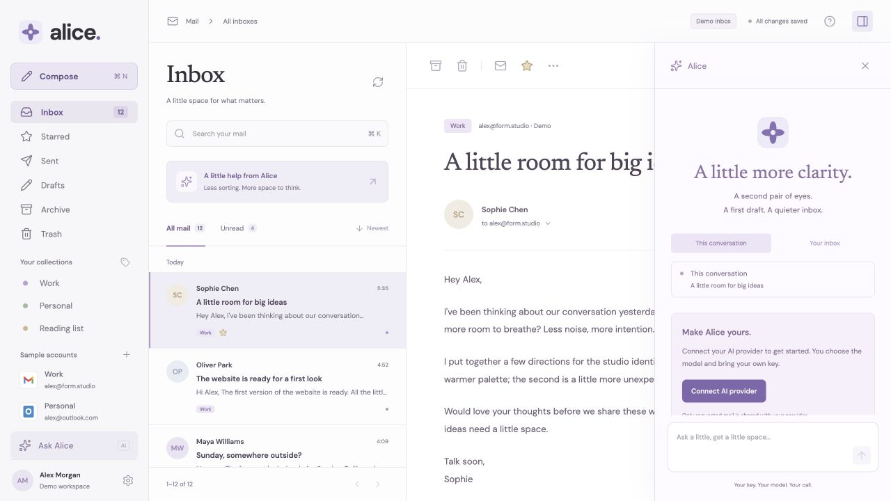

What this repo does: Alice is an AGPL-3.0-only email client with a Rust daemon shared by the desktop app, CLI, and terminal UI. It implements Gmail/Outlook authentication, IMAP/SMTP mail operations, and AI suggestions using the user's own key. I assumed one person using the desktop and terminal together, with two accounts and a growing local mailbox.

> 🧠 **From Hindsight memory (Alice email client)** — The desktop and CLI share one local Rust daemon; mobile remains a later phase. I checked these boundaries against the current source.

Completed two code-review passes using Ponytail audit and two UI/UX inspection passes using Impeccable, with separate design and technical assessments. Impeccable was updated to **v4.5.2**; both assessments were checked against that version and the updated detector was run. **Application source and existing tests were not changed.**

**Validation:** all 5 Rust tests passed; the production frontend build, Clippy with warnings denied, and CLI/API smoke suite passed. Additional isolated parser, store, HTTP, credential, browser, and terminal probes exposed failures outside those suites. No real email was sent and no real API key was used.

**20 prioritized findings: 13 P1, 7 P2; no P0.** P1 means fix before release; P2 means a narrower failure or a usable workaround. Each item distinguishes runtime/fixture evidence from source tracing where relevant.

**Must fix**

1. **[P1] Sending can permanently freeze an edited or discarded draft** — [daemon.rs](/Users/amruth/Documents/Codex/2026-10-11-create-a-new-project-called-alice/crates/alice-core/src/daemon.rs:223)
   - **What this is:** Sending claims a draft before contacting SMTP, preventing duplicate delivery.
   - **Problem:** Draft save/discard bypass the send lock while send awaits credentials. A controlled store interleaving produced a pending claim on an invalid or missing draft before any SMTP attempt.
   - **Fix:** Use the existing send mutex for draft save/discard too, and test the send/edit and send/discard interleavings.
   - **If we skip it:** A concurrent desktop or CLI edit can leave a draft impossible to send, edit, or discard.

2. **[P1] Reloading loses the message being written** — [Compose.tsx](/Users/amruth/Documents/Codex/2026-10-11-create-a-new-project-called-alice/apps/desktop/src/Compose.tsx:7)
   - **What this is:** Compose keeps typed fields in React state until Save or an in-app close.
   - **Problem:** I typed a subject/body and reloaded the review tab; Drafts remained empty. The header still said “All changes saved” before reload.
   - **Fix:** Persist draft edits while typing, retain unfinished recipients, and show saved status only after persistence succeeds.
   - **If we skip it:** Reloads and unexpected window/process closure can erase the user's work.

3. **[P1] Changing an AI endpoint reuses the previous endpoint's key** — [ai.rs](/Users/amruth/Documents/Codex/2026-10-11-create-a-new-project-called-alice/crates/alice-core/src/ai.rs:48)
   - **What this is:** Compatible AI services share one credential entry named ai-compatible.
   - **Problem:** An isolated credential store and two different loopback origins proved that changing the URL with no new key sends the first origin's key to the second.
   - **Fix:** Require a new key when the endpoint origin changes, or bind stored keys to that origin; test the cross-origin case.
   - **If we skip it:** A custom endpoint can receive a credential intended for another service.

4. **[P1] Untrusted email can manipulate the CLI terminal display** — [main.rs](/Users/amruth/Documents/Codex/2026-10-11-create-a-new-project-called-alice/crates/alice/src/main.rs:251)
   - **What this is:** Human-readable CLI output prints email fields and bodies directly.
   - **Problem:** A fixture containing terminal clear-screen and cursor-home sequences survived unchanged in alice read output. List fields use the same unsanitized output pattern.
   - **Fix:** Remove unsafe terminal control sequences from untrusted human-readable output while preserving ordinary text and line breaks.
   - **If we skip it:** A malicious email can erase or forge what the terminal appears to display.

5. **[P1] Replies ignore Reply-To** — [providers.rs](/Users/amruth/Documents/Codex/2026-10-11-create-a-new-project-called-alice/crates/alice-core/src/providers.rs:264); [CLI reply](/Users/amruth/Documents/Codex/2026-10-11-create-a-new-project-called-alice/crates/alice/src/main.rs:272)
   - **What this is:** All three clients address replies to the stored From address.
   - **Problem:** A message with From notifications@example.invalid and Reply-To support@example.invalid produced a CLI draft addressed to notifications. Desktop and TUI callers use the same rule.
   - **Fix:** Parse/store Reply-To and use it across all reply callers, falling back to From; add that fixture.
   - **If we skip it:** Replies reach the wrong mailbox or a no-reply address. [RFC 5322 identifies Reply-To as the suggested reply destination.](https://www.rfc-editor.org/rfc/rfc5322.html#section-3.6.2)

6. **[P1] Multipart messages silently lose inline content** — [providers.rs](/Users/amruth/Documents/Codex/2026-10-11-create-a-new-project-called-alice/crates/alice-core/src/providers.rs:335)
   - **What this is:** The body parser chooses the first readable MIME part.
   - **Problem:** A multipart/mixed fixture with two inline text sections kept the first and discarded the second. Choosing one representation is appropriate for alternatives, but mixed sections can both matter.
   - **Fix:** Choose a representation for multipart/alternative; combine readable inline sections for mixed bodies while excluding attachments.
   - **If we skip it:** Users and the AI assistant read incomplete mail without any warning.

7. **[P2] Moved mail can remain cached after remote deletion** — [store.rs](/Users/amruth/Documents/Codex/2026-10-11-create-a-new-project-called-alice/crates/alice-core/src/store.rs:156)
   - **What this is:** Reconciliation removes cached messages whose provider IDs disappear.
   - **Problem:** Moving mail clears its remote UID, but reconciliation only checks records with a UID. A move followed by remote deletion left the local record intact in a fixture.
   - **Fix:** Resolve and store the destination mailbox/UID after a move; reconcile unresolved moves using their Message-ID.
   - **If we skip it:** Archive or Trash can show mail the provider no longer has.

8. **[P2] Sent-message flags only change locally** — [daemon.rs](/Users/amruth/Documents/Codex/2026-10-11-create-a-new-project-called-alice/crates/alice-core/src/daemon.rs:185)
   - **What this is:** Star/read changes should reach IMAP-backed messages.
   - **Problem:** The handler skips every Sent message. A provider-backed Sent fixture returned success without credentials or remote work; subsequent sync reads the provider's unchanged flags.
   - **Fix:** Skip remote work only for local drafts and local messages without provider IDs; allow provider-backed Sent flag changes.
   - **If we skip it:** Stars and read status revert on sync and disagree with other email clients.

9. **[P2] Sending and syncing can create two Sent copies** — [store.rs](/Users/amruth/Documents/Codex/2026-10-11-create-a-new-project-called-alice/crates/alice-core/src/store.rs:214); [provider identity](/Users/amruth/Documents/Codex/2026-10-11-create-a-new-project-called-alice/crates/alice-core/src/providers.rs:296)
   - **What this is:** Local drafts and imported mail use different record IDs.
   - **Problem:** Completing a local delivery and importing its provider Sent copy produced two records with the same Message-ID.
   - **Fix:** Merge by account plus Message-ID when importing a sent copy, retaining the existing local ID and delivery record.
   - **If we skip it:** Ordinary successful sends can appear twice in Sent.

10. **[P2] Newest-first sorting fails across time zones** — [store.rs](/Users/amruth/Documents/Codex/2026-10-11-create-a-new-project-called-alice/crates/alice-core/src/store.rs:82)
    - **What this is:** The store sorts date strings; IMAP replaces normalized dates with offset-bearing timestamps.
    - **Problem:** A fixture sorted 08:00+02:00 ahead of 07:00Z, although the latter is one hour newer.
    - **Fix:** Normalize imported timestamps to UTC and compare actual instants for existing cached values.
    - **If we skip it:** Inbox order can put older mail ahead of newer mail.

11. **[P1] Collection filters and counts describe different mail** — [App.tsx](/Users/amruth/Documents/Codex/2026-10-11-create-a-new-project-called-alice/apps/desktop/src/App.tsx:47)
    - **What this is:** Collections filter a fetched page, while totals come from the broader server query.
    - **Problem:** Work displayed 5 rows but “1–12 of 12”; empty Drafts displayed Unread 4. Source tracing also shows that category matches on later pages can be hidden behind an empty first page.
    - **Fix:** Apply category filtering before server pagination and derive badges/totals from the same folder/account/filter scope.
    - **If we skip it:** Users mistake hidden messages for an empty collection and cannot trust counts.

12. **[P1] The assistant covers mail and keyboard focus** — [styles.css](/Users/amruth/Documents/Codex/2026-10-11-create-a-new-project-called-alice/apps/desktop/src/styles.css:112); [keyboard handling](/Users/amruth/Documents/Codex/2026-10-11-create-a-new-project-called-alice/apps/desktop/src/App.tsx:105)
    - **What this is:** A fixed 340px assistant overlays the reader below 1500px.
    - **Problem:** At 1280px and the supported 850px minimum, it hides message content. Keyboard navigation reached a fully covered Next message button; Escape also fails while Ask Alice has focus.
    - **Fix:** Reflow the panes or open a focused assistant view with a clear return path; manage opening/restored focus and handle Escape before the input guard.
    - **If we skip it:** Users lose reading context and can focus invisible controls, violating [Focus Not Obscured](https://www.w3.org/WAI/WCAG22/Understanding/focus-not-obscured-minimum.html).

13. **[P1] Secondary text and enabled icons fail contrast requirements** — [styles.css](/Users/amruth/Documents/Codex/2026-10-11-create-a-new-project-called-alice/apps/desktop/src/styles.css:127)
    - **What this is:** Pale foregrounds establish the visual hierarchy.
    - **Problem:** Rendered ratios included 3.62:1 for Work navigation, 3.90:1 for input values, 2.46:1 for search placeholders, and 2.45:1 for enabled toolbar icons.
    - **Fix:** Correct semantic foreground roles against their actual backgrounds and verify selected, input, placeholder, and icon states.
    - **If we skip it:** Important information remains difficult to read; these examples miss [text contrast](https://www.w3.org/WAI/WCAG22/Understanding/contrast-minimum.html) and [essential graphic contrast](https://www.w3.org/WAI/WCAG22/Understanding/non-text-contrast.html) requirements.

14. **[P1] Dialog identity and selected state are absent from accessibility semantics** — [Settings.tsx](/Users/amruth/Documents/Codex/2026-10-11-create-a-new-project-called-alice/apps/desktop/src/Settings.tsx:47); [App.tsx](/Users/amruth/Documents/Codex/2026-10-11-create-a-new-project-called-alice/apps/desktop/src/App.tsx:126)
    - **What this is:** Native dialogs and buttons already provide useful basic behavior.
    - **Problem:** Compose/Settings lack accessible dialog names, while active folders, filters, messages, and AI scopes are expressed through CSS classes only.
    - **Fix:** Associate dialog titles with aria-labelledby; expose current/pressed/expanded states and unread/starred status on existing controls.
    - **If we skip it:** Speech output cannot reliably identify the open task or active view. The [WAI dialog pattern](https://www.w3.org/WAI/ARIA/apg/patterns/dialog-modal/) specifies a named dialog.

15. **[P1] Character shortcuts can act outside the mail component** — [App.tsx](/Users/amruth/Documents/Codex/2026-10-11-create-a-new-project-called-alice/apps/desktop/src/App.tsx:100)
    - **What this is:** Global j/k/r/e shortcuts accelerate navigation and archive.
    - **Problem:** Source tracing shows they also operate from unrelated sidebar/header controls, with no disable/remap or component-focus restriction. Destructive shortcut activation was not executed.
    - **Fix:** Restrict character shortcuts to the focused mail component, or add non-character modifiers.
    - **If we skip it:** Speech input or accidental typing can archive/select mail; this misses [Character Key Shortcuts](https://www.w3.org/WAI/WCAG22/Understanding/character-key-shortcuts.html).

16. **[P1] The TUI keeps a stale account list** — [tui.rs](/Users/amruth/Documents/Codex/2026-10-11-create-a-new-project-called-alice/crates/alice/src/tui.rs:21)
    - **What this is:** Accounts are fetched once when the TUI starts.
    - **Problem:** After a fixture account was connected elsewhere and the inbox became empty, new compose still selected demo-work instead of the new real account.
    - **Fix:** Refresh accounts with mailbox state and expose the chosen From account before composing.
    - **If we skip it:** Desktop and TUI disagree, and a user can unknowingly compose through a non-delivering demo account.

17. **[P2] Network requests block the TUI event loop** — [tui.rs](/Users/amruth/Documents/Codex/2026-10-11-create-a-new-project-called-alice/crates/alice/src/tui.rs:51)
    - **What this is:** Fetch, sync, and mutation requests are awaited in the same loop that handles keys and drawing.
    - **Problem:** A four-second PATCH fixture prevented q from exiting until the request finished. The client permits requests lasting much longer.
    - **Fix:** Run requests outside the input loop, show an in-flight state, and keep navigation/quit responsive.
    - **If we skip it:** Slow providers make the terminal appear frozen.

18. **[P2] The TUI cannot browse past its first 100 messages** — [tui.rs](/Users/amruth/Documents/Codex/2026-10-11-create-a-new-project-called-alice/crates/alice/src/tui.rs:51); [API default](/Users/amruth/Documents/Codex/2026-10-11-create-a-new-project-called-alice/crates/alice-core/src/store.rs:88)
    - **What this is:** The daemon already exposes totals and offset pagination.
    - **Problem:** Source tracing shows the TUI requests the default 100, ignores total, and has no page controls. Two accounts with 100 Inbox messages each leave half inaccessible through ordinary browsing.
    - **Fix:** Reuse the existing offset/limit API and show page position plus total.
    - **If we skip it:** Available mail disappears from the terminal experience even though the desktop/CLI can retrieve it.

**Should fix**

19. **[P1] Account setup reveals developer prerequisites too late** — [Settings.tsx](/Users/amruth/Documents/Codex/2026-10-11-create-a-new-project-called-alice/apps/desktop/src/Settings.tsx:55)
    - **What this is:** Current OAuth setup requires the user's own Google/Microsoft app registration.
    - **Problem:** Add account first presents client-ID/secret fields; the prerequisite explanation is lower down, with no linked setup guide. Ordinary email users meet an unexpected developer task.
    - **Fix:** Explain self-managed OAuth before the form, provide exact provider guides, and clearly expose the supported Gmail app-password alternative.
    - **If we skip it:** People attracted by the polished inbox can abandon before connecting real mail.

20. **[P2] The TUI compose editor ignores cursor movement** — [tui.rs](/Users/amruth/Documents/Codex/2026-10-11-create-a-new-project-called-alice/crates/alice/src/tui.rs:233)
    - **What this is:** Text input only appends characters or removes the final character.
    - **Problem:** Typing Hello, Left, X saved HelloX rather than HellXo in a real terminal probe.
    - **Fix:** Track a visible cursor and edit at its position, or use the user's external editor for body editing.
    - **If we skip it:** Correcting a sentence requires deleting everything after the correction point.

The five Rust tests and smoke suite are useful, but they do not exercise these provider/parser/concurrency failures. The smallest useful additions are the exact fixtures above, including mixed MIME bodies, Reply-To, mixed-offset dates, sent-copy merging, and concurrent draft changes; avoid tests that merely repeat implementation details.

A separate optimized probe with 10,000 stored 8KB bodies took **188ms for three list scans** and about **107MiB peak resident memory**, even with a one-row result limit. This is a growth-cost warning: each desktop poll scans/deserializes bodies three times. No premature performance rewrite is needed at the present demo size.

---

Method: dual-agent (A: /root/ui_design_review · B: /root/ui_evidence_review)

**Design specificity verdict:** Alice feels authored for email. The paper-like reader, serif message headings, restrained violet accents, and familiar mailbox structure form a coherent identity. Preserve it while repairing workflow trust and accessibility.

**Deterministic scan:** Impeccable v4.5.2 / engine v0.1.14 returned **0 findings**, 0 advisory findings, and no false positives for apps/desktop/src. Browser measurements and behavior tests found problems the detector does not cover. Read-only browser evaluation prevented overlay injection; no live detector overlay is available.

**Overall impression:** The visual direction is strong. The largest opportunity is making its calm promises match real behavior: recover drafts, keep mail visible while using AI, expose state, and explain setup.

**Design health**

| # | Nielsen heuristic | Score / 4 | Key issue |
|---|---|---:|---|
| 1 | Visibility of system status | 2 | Saved status and filter counts can be misleading |
| 2 | Match with the real world | 2 | Familiar mail vocabulary gives way to OAuth jargon |
| 3 | User control and freedom | 2 | Assistant Escape/focus behavior is inconsistent |
| 4 | Consistency and standards | 2 | Selected views lack accessible state |
| 5 | Error prevention | 2 | Human AI approval is good; draft recovery is missing |
| 6 | Recognition rather than recall | 2 | Provider setup requires external knowledge |
| 7 | Flexibility and efficiency | 2 | Useful shortcuts, but global scope and AI layout hinder use |
| 8 | Aesthetic and minimalist design | 3 | Strong hierarchy; tiny pale peripheral text |
| 9 | Error recovery | 2 | Some errors name the failure without guiding recovery |
| 10 | Help and documentation | 1 | Shortcut hints exist; account setup guidance is insufficient |
| **Total** | | **20/40** | **Acceptable; significant improvements needed** |

All ten apply to this Operate surface.

**Technical UI health**

| Dimension | Score / 4 | Key finding |
|---|---:|---|
| Accessibility | 2 | Contrast, names/state, character shortcuts, hidden focus |
| Performance | 3 | Small build and short motion; repeated mailbox polling |
| Theming | 1 | Six color tokens, but 255 literal-color occurrences and late overrides |
| Responsive design | 2 | Basic layouts fit 850×640; assistant obscures content |
| Implementation integrity | 2 | Coherent design, but saved-state and count promises are unreliable |
| **Total** | **10/20** | **Acceptable; significant work needed** |

Assessment B initially scored integrity 3 and total 11/20; the confirmed unsaved-draft loss and misleading “All changes saved” state justify the final integrity score of 2. Desktop priorities map to findings 2, 11–15, and 19; terminal UX maps to 16–18 and 20.

**What works**

- The message body stays visually dominant. Body contrast measured 5.68:1, unread sender text 6.67:1, and the primary button 4.71:1.
- BYOK disclosure, explicit AI scope, draft-only replies, and human approval create a understandable boundary around automation.
- Native controls and labeled fields support basic keyboard use. Blank compose/settings open with useful focus and close with Escape; long search input produced a useful no-results state without horizontal overflow.

**Five UI/UX priorities**

1. **[P1] Protect writing and make saved state truthful** — finding 2.
   **Why:** Losing a reply breaks the trust established by “All changes saved.”
   **Fix:** Persist incomplete work, recover it after reload, and distinguish saving/saved/error.
   **Suggested command:** $impeccable harden.

2. **[P1] Give the assistant a deliberate layout and focus model** — finding 12.
   **Why:** Asking about mail currently hides that mail and permits invisible keyboard focus.
   **Fix:** Reflow when space permits; use a focused assistant view otherwise, with Back, Escape, and focus restoration.
   **Suggested commands:** $impeccable adapt, $impeccable harden.

3. **[P1] Make secondary information and state accessible** — findings 13–15.
   **Why:** Pale text, unnamed dialogs, silent selection, and global character shortcuts exclude low-vision, speech, and keyboard users.
   **Fix:** Correct measured contrast pairs, name dialogs, expose active states, and scope character shortcuts.
   **Suggested commands:** $impeccable colorize, $impeccable harden.

4. **[P1] Align filters, pages, and counts** — finding 11.
   **Why:** Five visible Work messages with a total of twelve, and unread badges on empty Drafts, undermine navigation.
   **Fix:** Use one server-side filter scope for rows, pagination, totals, and unread counts.
   **Suggested commands:** $impeccable harden, $impeccable clarify.

5. **[P1] Make connecting a real account understandable** — finding 19.
   **Why:** A first-time user expects sign-in and meets app-registration vocabulary.
   **Fix:** Show prerequisites early, link exact setup steps, and clearly distinguish supported connection routes.
   **Suggested commands:** $impeccable onboard, $impeccable clarify.

**Browser evidence at 1280×720:** opening the assistant clips the subject and paragraphs beneath its 340px panel.

**Cognitive load:** The inbox has low load: familiar groups and a clear reading hierarchy. The account form has three checklist failures—one decision at a time, working-memory support, and progressive disclosure—so load becomes moderate. Its two top-level settings choices, three mail providers, and two AI scopes are manageable; six folder destinations exceed four but are a familiar grouped navigation set. The avoidable load is carrying registration/permissions/callback information between provider consoles and Alice.

**Emotional journey:** The reader is the high point: space, legibility, and a calm rhythm. Account registration is the first valley; the assistant covering mail is the second. Human approval reassures users around AI, but losing a draft creates the worst ending to a writing session.

**Personas**

- **Alex, power user:** Work counts disagree with rows; assistant navigation reaches a covered button; TUI requests block input and browsing stops after 100 messages.
- **Sam, accessibility-dependent user:** Text/icon contrast misses AA, dialogs are unnamed, active views are not announced, and character shortcuts can fire away from mail. Screen-reader behavior itself was not tested.
- **Jordan, first-time user:** Client IDs and delegated permissions appear before sufficient guidance. AI setup also asks for an exact model ID; linking provider model/setup guidance would reduce guesswork.

**Four smaller observations left unranked**

- At 850×640, Settings initially lies below the viewport; the sidebar scrolls, so it remains reachable.
- Attachment buttons explain the preview's download limit only after clicking; expose that boundary in the affordance.
- Windows/Linux shortcut copy shows the Command symbol although the handlers also support Control.
- “This conversation” currently means one selected email; use wording that matches the documented absence of threading.

**Motion and responsive limits:** Short transform/opacity transitions are appropriate and no layout-property animation was found. Reduced-motion emulation confirmed the blanket .01ms rule; sync loses its moving indicator without a changing text label, but the busy sync path was not exercised. True 200% zoom, native WebKit behavior, physical devices, and frame-rate smoothness remain unverified; phone layouts were not treated as shipping requirements.

**Recommended sequence:** $impeccable harden for persistence/state/accessibility; $impeccable adapt for the assistant; $impeccable colorize for measured contrast; $impeccable onboard and $impeccable clarify for setup; then $impeccable polish. Re-run the audit and critique after fixes.

**Questions for the next pass**

**Run notes:** Target apps/desktop/src/App.tsx; slug apps-desktop-src-app-tsx; no ignore list. Assessments stayed independent and A finished before detector findings entered synthesis, including the update check. The updated CLI detector was clean. Fresh review tabs were closed and browser emulation reset; independent agents used Brave Work because their iab alias was unavailable. No mutable injection or Human overlay was available, and no critique live server was started. The existing preview remains open. Evidence is archived alongside this report; the temporary critique body was deleted and isolated probe fixtures remain under /tmp.

**Snapshot:** [.impeccable critique archive](/Users/amruth/Documents/Codex/2026-10-11-create-a-new-project-called-alice/.impeccable/critique/2026-10-11T07-24-12Z__apps-desktop-src-app-tsx.md) written successfully. First run for apps-desktop-src-app-tsx: 20/40; no trend yet.

- Which first batch matters most: draft/security/mail correctness, or keyboard/accessibility/assistant layout?
- At the minimum desktop size, should AI open a focused assistant view with Back, or share a reflowed workspace with the email?

**Verdict:** Preserve the visual direction. Fix draft durability, credential routing, terminal output, reply/parser correctness, and the send race before release.

**Not checked:** Real OAuth/mail providers and SMTP delivery, paid AI providers, actual OS credential-store behavior, Windows/Linux/native WebView runtime, screen readers, true 200% zoom, and frame-rate profiling.
**Risk:** The reported defects remain; this was a review with no application-source fixes.

